# SBBetter

**Live demo: [sbbetter.vercel.app](https://sbbetter.vercel.app/)**

**Turn disruption data into the traveller's best next move.** Built at **LauzHack 2026** for the SBB challenge
*"Assist customers in case of disruption"*.

When a line breaks, SBB publishes messages like *"Limited train service between Annemasse and Genève … Lines RE33,
RL1, RL3, RL4 and TERL2 are affected. Allow for delays and cancellations."* That is accurate, but it doesn't answer
the traveller's real question: **what should I do now, and how do I still get to Geneva?** Staff on the platform can,
but SBB can't put people at every affected station.

SBBetter is a mobile-first web app (installable as a PWA) shaped like SBB Mobile. On every journey it answers that
question with **one sentence and one connection**, and it gets that answer from past disruptions instead of waiting
for someone to write it.

<p align="center">
  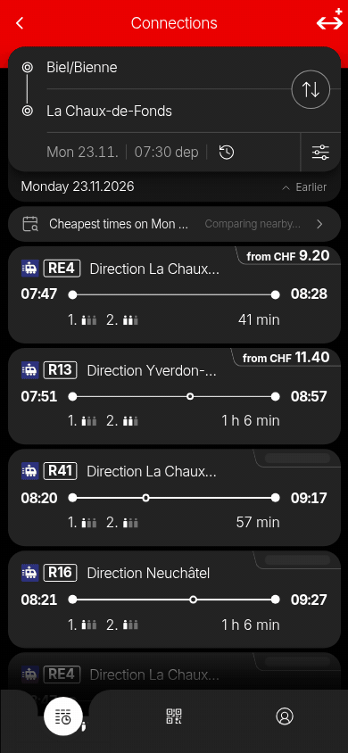
  <br><sub>Biel/Bienne → La Chaux-de-Fonds: Plan B on a normal day, then a simulated line closure.</sub>
</p>

## The challenge, and how we answer it

| SBB asked for a solution that… | What SBBetter does |
| --- | --- |
| understands **where the traveller wants to go** | Works from the traveller's own journey: a connection they searched, a saved trip, a ticket, or their daily commute. Each of these is a real timetable connection (OJP 2.0). |
| understands **how the disruption affects the journey** | Matches the disruption to the legs actually ridden: a late train, a change that no longer works, a cancelled train, or a closed stretch the train runs over (by its stops, and by its path for trains that don't stop there). |
| says **what the traveller should do next** | A **verdict card**: *"Take the RE 2 via Neuchâtel at 07:41, arriving 08:43 (17 min later)"*. The connection is searched live, checked not to run over the closed stretch, and shown in the timeline so you can open or buy it. |
| **works with incomplete information** | At minute zero there is usually no advice yet. **Line memory** fills the gap: the detour staff recommended the last times *this* stretch closed, and how long it usually took them to say it. A **duration forecast** gives "likely over around …" when SBB has no estimate yet, or shows how far its first estimates tend to overrun. |
| **recognises relevant updates and adapts** | **Disruption replay**: three real September 2026 disruptions play on today's live trains, update by update, as the timetable (VIA), the public ticker and the staff ticker published them. At each update the alert, the end forecast and the one-sentence advice are rebuilt from what was known by then. Live OJP situations work the same way. |
| **informs travellers at the right moment** | In a replay, a notification appears only when an update changes what *this* traveller should do; advice for other lines sends nothing. **Commute alerts** do the same for real: in the hour before each usual departure the server checks the train and sends one push notification when something is wrong (line closed → Plan B, change won't work, late, likely late), and again only when the news changes. |
| **uses the publication timestamps** | They order every replay step, measure how late advice came (line memory), and give the forecast how long a disruption has already lasted. |

### What we built from the data

The hackathon export holds the **public live ticker** (incidents, their version history, messages, since 2024), the
**internal KULT live ticker** (staff messages for September 2026) and **timetable disruption information** (the VIA
event log, `Ereignismeldungen`). Three offline scripts (Python, standard library only) turn it into small JSON files
the app ships with. The export itself stays out of git (see *The SBB export* below).

- **Disruption replays**: `scripts/build-replays.py` → `public/replays.json`. Uses all three sources. Three real
  September 2026 disruptions, each as a timeline of updates: when VIA put it in the timetable and which lines and stops
  it closed, every version of the public ticker incident (with SBB's end estimate), the control centre's messages, and
  a few staff messages translated into English. VIA's closed stops decide which live trains are hit.
  *Example:* Renens – Morges, 17 Sep. SBB's end estimate moved 18:30 → 20:30 → 21:00 → 23:59, and staff ordered buses
  76 min before the public heard of them. A Lausanne → Genève traveller gets 6 messages over 6.5 hours.
- **Line memory**: `scripts/build-line-memory.py` → `public/line-memory.json`.
  550 incidents on 159 stretches since March 2024. For each stretch: every past disruption with cause and duration,
  the detours staff recommended ("via …") with a quote and how late that advice came, replacement buses, and whether
  tickets were also valid on another route. For each cause: the usual order of events (buses announced, detour advice,
  specialists on site, new forecast), as minutes after the start.
  *Example:* when Biel/Bienne – Reuchenette-Péry closed, staff wrote "travel via Neuchâtel" in four of six
  incidents, on average more than an hour in. SBBetter offers that detour at minute zero, as a real connection.
- **Disruption forecast**: `scripts/build-disruption-model.py` → `src/lib/disruption-model.json`.
  For each cause: past durations, how far SBB's first announced estimate overran, how often replacement buses came and
  when. Forecasts are quantiles of past cases that had already lasted as long as the current one. It is fitted only on
  data before September 2026, so in a replay it makes a real prediction. Backtest on the 13 September disruptions with
  an SBB estimate: SBB's first estimate held in 3, our "80 % sure" time in 8. The app shows this under an expanded
  service alert and in the replay.

<table>
<tr><td align="center" valign="top" width="33%">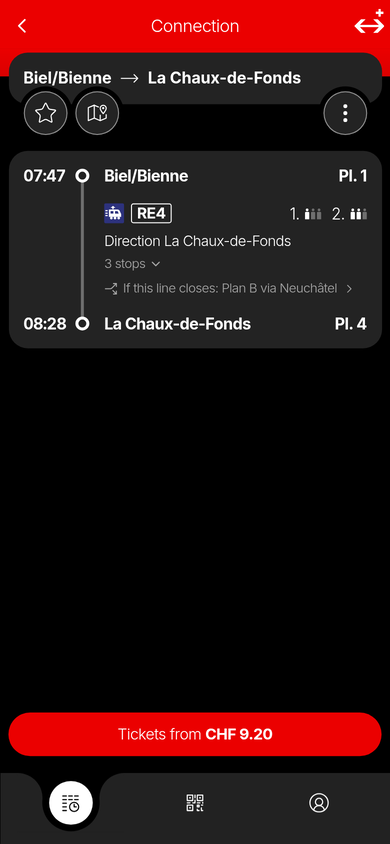<br><sub>Normal day: one muted line with the Plan B</sub></td><td align="center" valign="top" width="33%">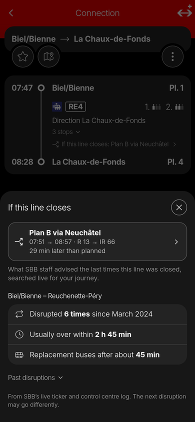<br><sub>Line memory: the Plan B searched live, and the stretch's history</sub></td><td align="center" valign="top" width="33%">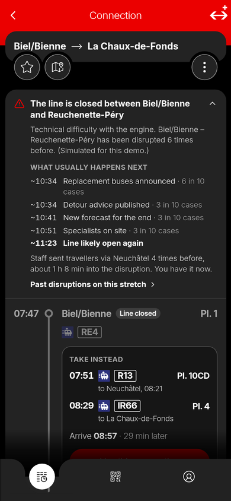<br><sub>Line closed: what usually happens next, and when</sub></td></tr>
</table>

In addition, a **delay forecast** for each leg ("likely 6 min late") comes from a LightGBM model trained on SBB actual
times (Ist-Daten, ~6M arrivals, Nov 2025 to Sep 2026) together with the weather forecast. It is exported to
`public/delay-model.json` and evaluated in the browser (`src/lib/delay-model.ts`); the training code is not in this repo.
The export carries five models and the app shows one (the 80th percentile): run `node scripts/trim-delay-model.mjs`
after a new export to drop the rest (4.6 MB -> 1.1 MB).

<table>
<tr><td align="center" valign="top" width="33%">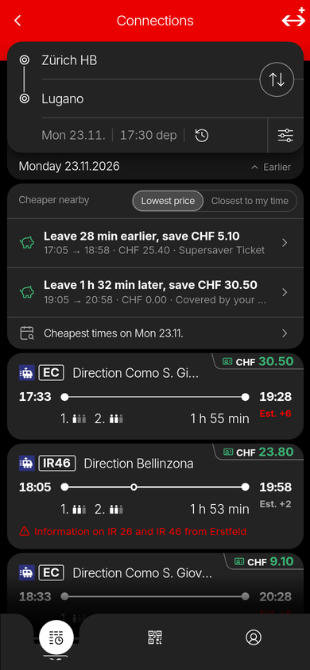<br><sub>Delay forecasts (“Est. +6”) next to arrival times, live prices, cheaper departures nearby</sub></td><td align="center" valign="top" width="33%">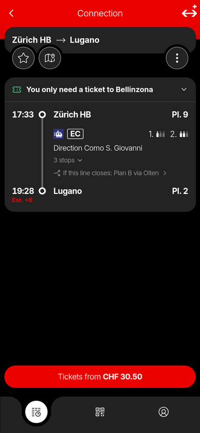<br><sub>The forecast sits under the time it belongs to; live delays replace it</sub></td><td align="center" valign="top" width="33%">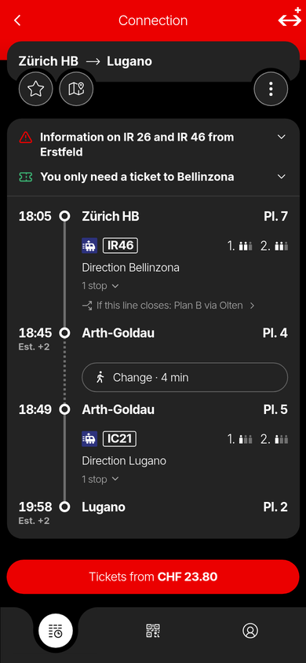<br><sub>A real service alert from OJP, attached to the connection it affects</sub></td></tr>
</table>

### Demo walkthrough

The screenshots are from the running app with live OJP data, searching trains for Monday 23.11.2026.

**Main demo: replay a real disruption.** Profile → Demo → **Replay a real disruption** and pick one (or open any URL
with `?replay=renens-morges`). The app searches the journey now and opens the first train the disruption hits. Step
through the updates with the dock above the tab bar (**Next** / back, or **→ / ←**); tap it to see what the traveller
is told, "When will it be over?" (our forecast vs SBB's vs what happened), and every update with its source. Details
in *Replaying a real disruption* below.

<table>
<tr><td align="center" valign="top" width="33%">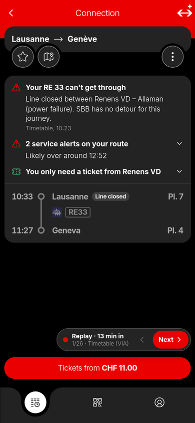<br><sub>Minute 13: the timetable (VIA) closes the line; the app already says this train can't get through</sub></td><td align="center" valign="top" width="33%">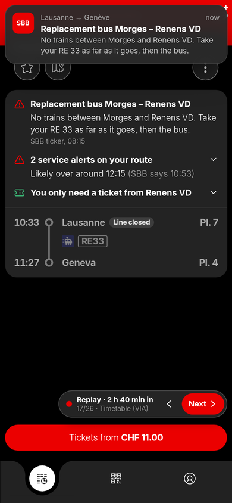<br><sub>Update 17: buses are published, so a notification tells this traveller what changed</sub></td><td align="center" valign="top" width="33%">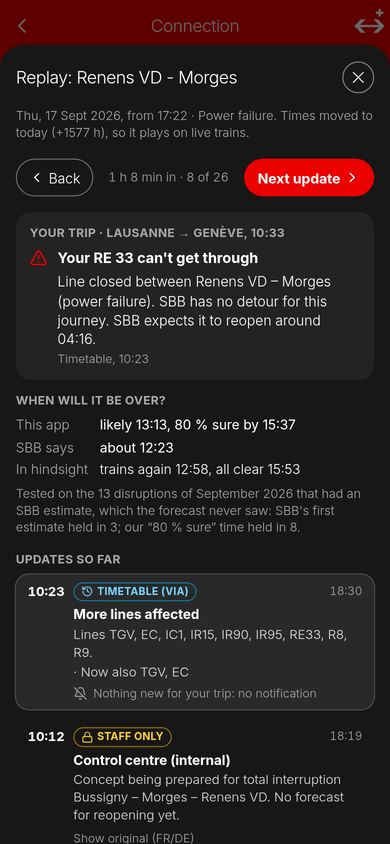<br><sub>The sheet: our forecast vs SBB vs what happened, and every update with its source</sub></td></tr>
</table>

**Then, on any journey:**

1. **Plan** → search *Biel/Bienne → La Chaux-de-Fonds* (or set it up as your commute) and open the 07:47 RE 4.
2. On a normal day, a muted line under a train says *"If this line closes: Plan B via …"*. Tap it to see that Plan B
   searched live, plus the stretch's history.
3. **⋮ → "Simulate a disruption"** and choose *Small delay*, *Missed connection*, *Cancelled train* or *Line closed*.
   The verdict card tells you what to do, the timeline shows what happens to each leg, and the recommended
   alternative is a real connection. *Line closed* uses a stretch this route really runs over, with its real cause,
   its forecast and the detour from its own history.
4. **Profile → Notifications → Commuter route**: set up a commute, then "Check my commute now" to get the push
   notification (production build, VAPID keys needed; see *Commute alerts* below).
5. **Offers** → Buy. In hackathon demo mode this adds a demo ticket with a fake QR code.

<table>
<tr><td align="center" valign="top" width="33%">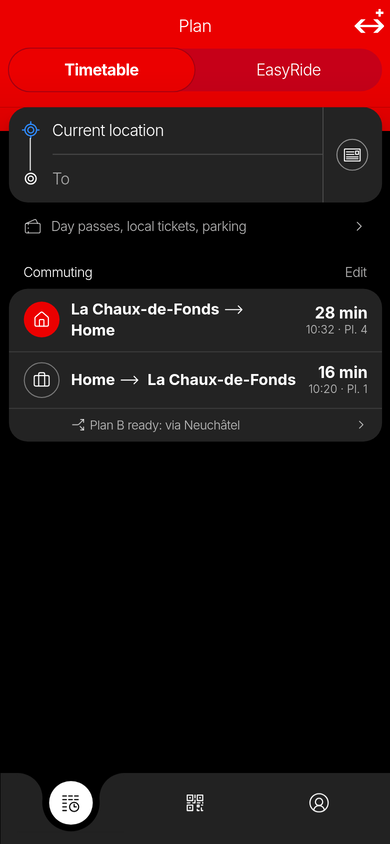<br><sub>Plan: the commute, with its Plan B ready</sub></td><td align="center" valign="top" width="33%">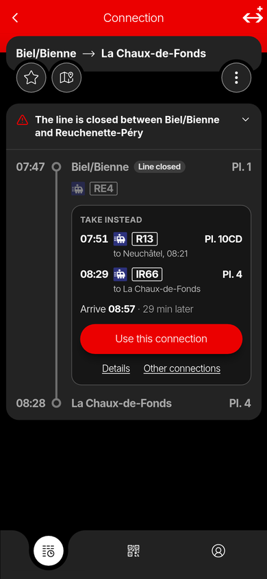<br><sub>Line closed: take this instead, a real connection</sub></td><td align="center" valign="top" width="33%">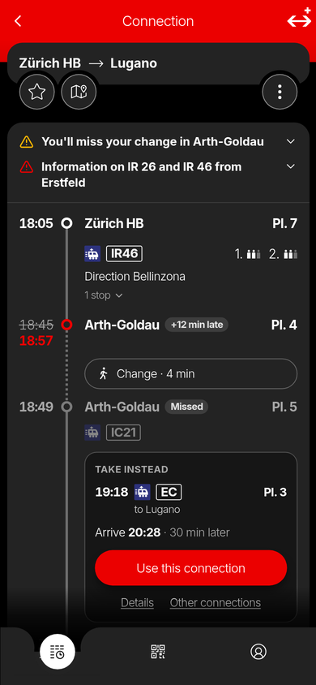<br><sub>Missed connection: the change in Arth-Goldau won't work</sub></td></tr>
</table>

The disruptions in step 3 are simulated, because the live feed can't produce one on demand; the replay uses real ones.
Everything they lead to (the alternative connection, the history, the forecast) is real.

### Also in the app

Live NOVA prices (OJP Fare) and "leave 20 min later and save CHF 12" suggestions, travelcard coverage (GA, Half Fare,
zone and area passes, Night GA hours) with tickets for the uncovered stretch, a departure board and maps (MapLibre),
an EasyRide-style flow, and tickets that open offline.

## Run

```bash
pnpm install      # also copies MapLibre's worker into public/
cp .env.example .env.local   # optional: add your OJP_API_KEY (see below)
pnpm dev          # http://localhost:3000  (use phone width / devtools device mode)
pnpm build && pnpm start
pnpm test         # unit tests (Vitest); pnpm test:watch while working
```

## What's real vs. mocked

| Area | Source |
| --- | --- |
| Stop search, connections, departure boards, map stops | **Live** — official [OJP 2.0](https://opentransportdata.swiss/en/cookbook/open-journey-planner-ojp-landing-page/) API when `OJP_API_KEY` is set, otherwise (or on any OJP error) [transport.opendata.ch](https://transport.opendata.ch). See "Timetable data" below |
| Real-time delays, platforms, occupancy, disruptions | **Live** via OJP (delays/occupancy also via opendata) |
| "Current location" routing | Browser geolocation; without a fix, the app asks for a starting stop instead of guessing. OJP routes from the exact coordinate incl. the walk to the first stop; without OJP it snaps to the nearest stop |
| Map | MapLibre + CARTO dark vector tiles |
| Prices / offers | **Live** NOVA prices (cheapest ticket, e.g. Supersaver, full fare or Half Fare) via the OJP Fare API when `OJP_FARE_API_KEY` is set — `src/lib/server/ojp-fare.ts`, `src/lib/fares.ts`. Otherwise a **mock** estimate by distance — `src/lib/pricing.ts`. Class upgrades and City add-ons are always modelled |
| User, travelcards, favourites | **Mock** — `src/lib/mock-data.ts` |
| Disruption verdict card | **Simulated** disruption (Connection → ⋮ → "Simulate a disruption"), **live** recommended alternative — `src/lib/disruption.ts` |
| Disruption replay | **Real** September 2026 disruptions from the SBB export (timetable/VIA, public ticker, internal KULT ticker), update by update, laid over **live** trains — `public/replays.json`, `src/lib/replay.ts`. See "Replaying a real disruption" below |
| Line memory | **Real history** from the SBB hackathon export: every disruption of a stretch since March 2024, the detour staff recommended, the usual order of events — `public/line-memory.json`, `src/lib/line-memory.ts`. The way round is a **live** connection. See "Line memory" below |
| Purchased tickets, saved trips | `localStorage` — `src/lib/store.ts` (Profile → "Reset demo data") |
| Commute alerts | **Real** web push before each commute (Profile → Notifications → Commuter route). Other notification switches are demo only. See "Commute alerts" below |

## Layout

```
src/app/
  plan/                 Timetable search + home (commute, Upcoming, recents, Other tickets sheet) and EasyRide
  connections/          Connection list  (?from&to&date&time… in the URL)
  connections/detail/   Single connection (&key=…): detail-view.tsx wires up timeline.ts (the model),
                        itinerary.tsx, alerts.tsx, reroute.tsx, sheets.tsx and share.ts
  offers/               Offers + mock purchase → adds a ticket
  tickets/              Tickets you show: SwissPass, valid tickets, running EasyRide, past purchases
  profile/              Profile and settings sheets
  api/transport/        Proxy to the timetable API (swap upstream here)
src/components/
  ui.tsx                Header, Segmented, Card, Sheet, Toggle, buttons…
  journey.tsx           ModeBadge, LineLabel, Timeline, ConnectionCard, Capacity
  journey-search-card   From/To/date + Advanced search sheet
  plan/                 Map, location picker, departure board
src/lib/                API client + types, URL journey state, formatting, store
```

Journey state lives in the URL (`src/lib/journey-query.ts`), so every screen is reload-safe and shareable.

## Tests

`pnpm test` runs the unit tests next to the code they cover (`*.test.ts`). They cover the logic that is
easy to get subtly wrong: OJP parsing, fare refs and NOVA price parsing, travelcard coverage (Night GA
hours, zone and area passes from `public/passes/`), connection keys and re-routes, the disruption
forecast, line memory (against the real `public/line-memory.json`), the connection timeline and the
request cache, and the replay engine (which trains each real disruption hits, and the messages a traveller gets,
against the real `public/replays.json`). Test builders for connections are in `src/test/factories.ts`.

The OJP parsing tests read real responses saved in `src/lib/server/__fixtures__/`. When OJP may have
changed its format, capture fresh ones and run the tests:

```bash
node --env-file=.env.local scripts/capture-ojp-fixtures.mjs && pnpm test
```

## Timetable data

The browser only ever talks to `/api/transport/{locations,connections,stationboard}` using
transport.opendata.ch's query parameters and JSON shape (`src/lib/transport.ts`). The route
handler decides the upstream:

- **OJP 2.0** (`src/lib/server/ojp.ts`) when `OJP_API_KEY` is set. It builds the SIRI/XML
  requests (LocationInformation, Trip, StopEvent), parses them and converts them to the opendata
  shape. It also adds `accessWalk` (walk from a `coord:lat,lon` origin) and `disruptions` (OJP
  situations) to connections. Stop ids are converted from `ch:1:sloid:N` to UIC (`8500000 + N`).
- **transport.opendata.ch** as the fallback, and for features not mapped to OJP yet (product
  filters from Advanced search). `via` goes to OJP as a `<Via><ViaPoint>`.

The `X-Data-Source: ojp | opendata` response header shows which one answered. To get a key, sign up at
[api-manager.opentransportdata.swiss](https://api-manager.opentransportdata.swiss), subscribe to
the OJP 2.0 API and put the token in `.env.local`. The free tier allows 50 req/min and 20k/day.
Identical timetable requests share one upstream call, and its answer is reused for a few seconds
(`src/lib/server/upstream-cache.ts`).

### Fares (OJP Fare / NOVA)

Every OJP connection carries a `fareRef` that holds its raw `<Trip>` XML itself, deflated and signed
with a key derived from the API key (or `FARE_REF_SECRET`), so any server instance can price it. The
client sends `POST /api/transport/fares` with `{"refs": […], "hta": true}`. The server swaps platform refs for
their stop place, drops real-time fields and sends an `OJPFareRequest` to
`https://api.opentransportdata.swiss/ojpfare/`. From the result it takes the cheapest product per
class. Gotchas:
- The `Traveller` must contain an `<EntitlementProducts>` element. Leave it empty for full fare, or
  put `HTA` in it for Half Fare. Without it the service returns a 500.
- OJP Fare is a separate API product with its own subscription and key (`OJP_FARE_API_KEY`).
- It is an integration test system that prices only future trips, and only within Switzerland.

Note: in the opendata shape `coordinate.x` is **latitude** and `y` is **longitude**.

## The SBB export (local only)

The build scripts below read the SBB LauzHack export (`Daten`, from the hackathon Discord). It is internal
SBB data, with staff names and phone numbers in the KULT log, so it is **not in git**: keep it at
`data/Daten/` (gitignored), which the scripts read by default, or pass another path. The app itself only
needs the JSON files they write, which are committed.

```
data/Daten/extern-liveticker/   incident, incident_audit, message, message_audit, reason (CSV)
data/Daten/intern-liveticker/   KULT: Ereignisfälle, messages, log (CSV)
data/Daten/Ereignismeldungen/   Ereignismeldungen Via.xlsx
```

## Replaying a real disruption

The demo for the SBB challenge. Three real disruptions from September 2026 play on today's trains, update
by update, as SBB's three sources published them:

| Replay | Follows | What it shows |
| --- | --- | --- |
| `renens-morges` (17 Sep, power failure) | Lausanne → Genève | No way round by train. SBB's end estimate moved 18:30 → 20:30 → 21:00 → 23:59; staff ordered buses 76 min before the public heard of them |
| `puidoux-vauderens` (25 Sep, fire) | Lausanne → Bern | Line memory names "Plan B via Biel/Bienne" at minute 4; SBB's ticker says the same at minute 28 |
| `wadenswil-pfaffikon` (10 Sep, overhead line) | Zürich HB → Chur | "Travel via St. Gallen", then the advice withdrawn, then one track open again |

**Running it:**

- Profile → Demo → **Replay a real disruption**, or a connection's ⋮ → "Simulate a disruption" → "Replay a
  real disruption", or open any URL with `?replay=renens-morges` (`&step=5` to jump in). The app searches
  the journey now, opens the first train the disruption hits and saves it as the trip you are on: Plan → "On
  your way" shows it with the disruption and what to do, for as long as the replay runs.
- On the trip, the disruption gives the same verdict as a simulated one: the ride over the closed line is
  marked "Line closed" and a real connection to "Take instead" sits in the timeline, ready to accept. The way
  round is SBB's detour once the ticker names one for this journey, else line memory's, else any connection
  that keeps off the closed stretch, else the replay's hand-picked one (Lausanne – Genève: across the lake
  via Évian).
- A dock above the tab bar steps through the updates: **Next** / back, or the **→ / ←** keys on a laptop.
  Tap it for the sheet: what the traveller is told, "When will it be over?" (our forecast, SBB's, and in
  hindsight), and every update so far with its source (timetable, public ticker, staff only) and whether
  it changed anything for this trip.
- When a step changes what the traveller should do, a notification slides in (the "right moment"). Updates
  that don't concern the trip (advice for Lausanne – Neuchâtel when going to Genève) send nothing.
- Stop it with the ✕ on the dock (or from the sheet, or "Reset demo data"). That also removes the trip it saved.

**How it works:** the update shown happens "now"; the start and every clock time move by the same
amount. The disruption, as it stood at that update, becomes an ordinary service alert on each live
connection that runs over the closed stretch (`withReplay`). The match uses the closed stops from VIA and
the ticker text, and the geometry of the train's stops, so an IC that runs through Renens – Morges without
stopping counts and Lausanne – Yverdon does not. The alert, the "likely over" forecast and line memory's
Plan B then work exactly as for a live disruption. On top, `nextMove` gives one sentence built only from
what was known by then: SBB's detour when the advice line concerns this journey (searched as a real
connection), the replacement bus, buses or first trains that only the control centre knew about yet, or
"can't get through" with SBB's estimate.

The end forecast is fitted on data before September 2026, so in a replay it is a real prediction. Tested on
the 13 September disruptions with an SBB estimate: SBB's first estimate held in 3, our "80 % sure" time in 8
(shown in the app under an expanded service alert).

```bash
python3 scripts/build-replays.py [path/to/Daten]   # → public/replays.json (~65 KB)
```

The script reads all three sources: the VIA event log (`Ereignismeldungen`), the public ticker's incident
and message history, and the KULT messages. Which incidents, which journey, and the picked staff messages
with their English translations are set at the top of the script.

## Commute alerts

Profile → Notifications → **Commuter route** subscribes the device to push notifications. In the hour
before each usual departure (weekdays), the server looks at the first train at or after that time and
sends one notification when something is wrong:

- **Line closed** (a live service message on a stretch line memory knows): the Plan B, searched live,
  e.g. "Plan B: RE 2 via Neuchâtel at 07:41, arriving 08:43 (17 min later)". Tapping opens it.
- **Change won't work**, **late** (live data, from 3 min) or **likely late** (delay forecast, from 5 min),
  with where staff sent people the last times the line closed.
- Any other service alert on the way.

Each piece of news is sent once; it is sent again only when it changes (a delay growing by 5 minutes, a
closure). "Check my commute now" sends the next leg's state straight away, "runs on time" included.
Logic: `src/lib/commute-alert.ts` (what to say), `src/lib/server/commute-alerts.ts` (who, when, sending),
`src/app/api/push/` (subscribe, cron, check now), `src/lib/push.ts` (browser), `public/sw.js` (showing it).

Setup: put a VAPID key pair in `.env.local` (see `.env.example`). Then:

- **Self-hosted** (`pnpm build && pnpm start`): the server checks every 5 minutes by itself
  (`src/instrumentation.ts`); subscriptions are kept in `.data/commute-alerts.json`.
- **Serverless (Vercel)**: there is no long-running process and no lasting disk. Add Postgres (Neon,
  which sets `DATABASE_URL`; the table is created on first use) or Upstash Redis (Vercel KV:
  `UPSTASH_REDIS_REST_URL`/`_TOKEN` or `KV_REST_API_URL`/`_TOKEN`), set
  `CRON_SECRET`, and call `GET /api/push/check` with `Authorization: Bearer $CRON_SECRET` every
  5 minutes. Vercel Cron does that on Pro; on Hobby it runs at most daily, so use an external
  scheduler (a GitHub Actions schedule, cron-job.org…).

On iPhone, web push only works in the app added to the Home Screen (iOS 16.4+); the switch says so.
Push needs the service worker, which only runs in a production build.

## Buying in the SBB app

**Hackathon demo mode is on by default** (`src/lib/flags.ts`): "Buy" adds a demo ticket with a fake
QR code right away. Set `NEXT_PUBLIC_DEMO_TICKETS=0` and rebuild to use the real flow below.

Tickets are bought in SBB Mobile (deep link from Offers). The SBB app can't call back or report a
purchase, so Offers saves a *pending purchase* (`store.ts`) and `components/purchase-return.tsx` asks
"Did you buy the ticket?" when the traveller comes back. That happens when the page is shown again, or
on a later launch within 24 h. "Yes" adds the ticket (and the trip, if set to be saved), marked
`source: "sbb-app"`. Those tickets show no code here: they link to the SBB app, which holds the real,
signed ticket.

## Offline tickets

The Tickets page opens with no signal (tunnel, abroad without data), even if it was never opened
before: the service worker saves it with its scripts, styles and travelcard data when it installs,
and refreshes that copy while online (`public/sw.js`). The tickets themselves are in `localStorage`.
On a weak signal a saved page is shown after 3.5 s instead of waiting for the network.

## Line memory (details)

Disruptions repeat, and so does the advice: when Biel/Bienne – Reuchenette-Péry broke, staff wrote
"travel via Neuchâtel" four times out of six, on average over an hour in. Line memory gives that
advice at minute zero.

```bash
python3 scripts/build-line-memory.py [path/to/Daten]   # → public/line-memory.json (~100 KB)
```

The script reads the hackathon export (public live ticker incidents and staff messages, the control
centre's KULT log) and writes, per stretch: every past disruption with cause and duration, the
detours staff recommended ("via …") with a quote and how late the advice came, replacement buses,
and where tickets were also valid. Per cause it writes the usual order of events. Station names are
matched to the official stop list (`scripts/train-stops.json`, from data.sbb.ch).

In the app (`src/components/line-memory.tsx`):

It never gets a row of its own; it sits where it applies:

- **Connection page, normal day**: one muted line under the train it concerns, "If this line closes:
  Plan B via Biel/Bienne". It opens a short sheet: that Plan B searched live for this journey, then three
  or four facts about the stretch (how often, how long, buses, tickets), with the dated history folded away. Only shown when staff advised a way round before; counts and durations stay in the sheet.
- **Connection page, during a disruption** (a live service message, or ⋮ → "Simulate a disruption" →
  "Line closed"): inside the alert. The way round as a real connection sits directly under
  "Likely over around …"; expanding the alert adds what usually happens next, with clock times.
- **Plan → Commuting**: a slim last line of the commute card, "Plan B ready: via Neuchâtel".

A connection is matched to a stretch by its stops, and for trains that run through without stopping
by the path travelled (OJP leg projection). Without OJP only stops count, so fast trains match less.
A detour is only offered when the connection found does not run over the closed stretch after all.

## Credits

Built at LauzHack 2026 for the SBB challenge "Reimagining travel during disruptions". Data: the SBB hackathon export (public live ticker, internal KULT live ticker, VIA event log), [OJP 2.0](https://opentransportdata.swiss) and [transport.opendata.ch](https://transport.opendata.ch). Not an official SBB product.
